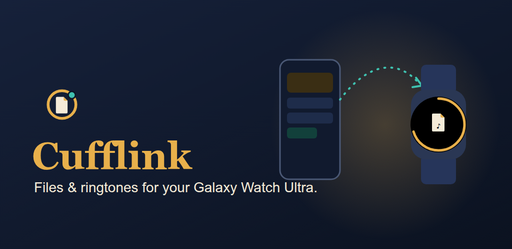

<p align="center">
  
</p>

<h1 align="center">Cufflink</h1>
<p align="center"><b>Files, ringtones & sounds — for your wrist.</b><br/>
An open-source file manager and sound installer built for the <b>Samsung Galaxy Watch Ultra</b>,
with a phone companion that beams files across. Other Wear OS 4+ watches should work too.</p>

<p align="center"></p>

---

## Why

On the Galaxy Watch Ultra, Settings will only let you pick a ringtone, notification sound or alarm
from the sounds already on the watch, and there's no on-watch way to add one. Opening
a photo, a PDF or a text file on the watch is just as awkward. Cufflink handles both.

## What it does

| | |
|---|---|
| **Beam** (phone) | Send any file to the watch from the Cufflink app, or from **any app's Share sheet → "Beam to watch"**. Streams over the Wearable Data Layer with a live progress bar. |
| **Make a watch sound** (phone) | Choose an audio file and tap **Ringtone / Notification / Alarm**. The watch files it in the right system folder and, if allowed, switches it on. No tapping on the watch. |
| **Pocket** (watch) | Your inbox for beamed files, newest first. Every arrival posts a notification; tapping it opens the file. |
| **Sound Shelf** (watch) | Shows the ringtone, notification and alarm sounds in use now (tap one to hear it), then every sound the watch could switch to. |
| **Drawer** (watch) | Browse the watch's Pictures, Sounds and Videos. With all-files access you can browse every folder. |
| **Peek** (watch) | Built-in viewers: **images** (pinch, or swipe round the touch bezel to zoom), **audio** (swipe round the touch bezel to scrub ±5 s, with a progress ring round the screen edge), **video**, **text**, and **PDF** (swipe round the touch bezel or tap a side to change page). |
| **Send back** (watch) | Send any watch file to the phone. It's saved to `Downloads/Cufflink`. |
| **Powers** (watch) | Shows every permission and whether it's granted, and gives the adb line for the two that the Galaxy Watch Ultra has no settings screen for. |

The **bezel gauge** is a brass ring around the edge of the watch's home screen that fills
up with used storage. The audio player reuses it as a progress ring.

## How the ringtone part works

1. **Stage:** the file is copied into MediaStore under `Ringtones/`, `Notifications/` or
   `Alarms/` with the matching `IS_RINGTONE` / `IS_NOTIFICATION` / `IS_ALARM` flag.
   That's enough for it to show up in the watch's own **Settings → Sounds** picker, and
   it needs no permission.
2. **Apply:** `RingtoneManager.setActualDefaultRingtoneUri` sets it as the default. This
   needs `WRITE_SETTINGS`. The Galaxy Watch Ultra has no screen to grant it, so grant it
   once over adb:

```bash
adb shell appops set com.ogenrwotdaniel.cufflink WRITE_SETTINGS allow
adb shell appops set com.ogenrwotdaniel.cufflink MANAGE_EXTERNAL_STORAGE allow   # optional: browse every folder
```

`tools/grant-watch-powers.sh <watch-serial>` runs both commands for you. Without them,
step 1 still works and you finish the job in the watch's own Settings.

## Install

Needs a phone and a watch paired through Galaxy Wearable, and adb on both
(watch: **Settings → Developer options → Wireless debugging**; run `adb pair` first,
because `adb connect` on its own fails).

```bash
git clone <this repo> cufflink && cd cufflink
tools/install.sh <phone-serial> <watch-serial>
tools/grant-watch-powers.sh <watch-serial>        # optional but recommended
```

> Both APKs must be signed with the **same key**. The Data Layer only connects apps with
> the same package name *and* signature. Debug builds made on one machine qualify.

No phone? The watch app runs on its own (`standalone = true`): Drawer, Peek and the
Sound Shelf all work offline. Only Beam needs the phone.

Don't want to install anything yet? `tools/push-sound.sh song.mp3 ringtone <watch-serial>`
pushes a sound straight into the system picker.

## Architecture

```
┌──────────── :mobile ────────────┐        ┌───────────── :wear ─────────────┐
│ MainActivity (+ share target)   │        │ MainActivity · SwipeDismissNav  │
│ BeamQueue  ── one at a time ──┐ │        │ Home · Pocket · Shelf · Drawer  │
│ PhoneBeamListenerService      │ │        │ Peek (image/audio/video/text/   │
│   └─▶ Downloads/Cufflink      │ │        │       pdf) · Actions · Powers   │
└───────────────────────────────┼─┘        │ PocketListenerService ─▶ Pocket │
                                │          │ SoundInstaller ─▶ MediaStore +  │
                                ▼          │                 RingtoneManager │
        ┌──────────────── :shared ─────────┴─────────────────────────────────┐
        │ BeamProtocol  "CUFF" magic · version · name · mime · size · role   │
        │ BeamTransport ChannelClient stream, .part file → rename on success │
        │ FileNames (path-traversal-proof) · FileKind · Sizes  — unit-tested │
        └────────────────────────────────────────────────────────────────────┘
```

- **ChannelClient, not DataItem/Asset.** A channel streams, reports progress and keeps
  nothing once the transfer ends. Assets are buffered whole by the Data Layer.
- **Every beam starts with a header** (magic `CUFF`, version, name, MIME, exact size,
  sound role). A stream without the magic is refused. A transfer that arrives short is
  deleted rather than left looking complete.
- **Names from the wire are untrusted.** `FileNames.sanitize` strips paths, `..`, control
  characters and leading dots, and limits the length, so a beam can't write outside the Pocket.
- **One `:shared` module** holds the contract for both ends, so the two copies can't drift apart.

## Build

| | |
|---|---|
| Gradle / AGP | 9.6 / 9.4.1, Kotlin 2.4 (AGP built-in Kotlin) |
| Phone | minSdk 29, targetSdk 36, Jetpack Compose + Material 3 |
| Watch | Galaxy Watch Ultra (SM-L705); minSdk 33 (Wear OS 4+), targetSdk 36, Compose for Wear OS Material 3 1.7 |

```bash
./gradlew assembleDebug testDebugUnitTest lintDebug
```

## Status: honest notes

- **Not yet run on a real watch.** It builds, the unit tests pass and lint is clean, but
  nothing has been checked on hardware yet.
- Whether a staged sound shows up in **Samsung's** sound picker (rather than stock
  Wear OS's) still needs checking on the Galaxy Watch Ultra.
- Large beams run in a process-scoped coroutine, not a foreground service. If you leave
  the phone app mid-transfer, Android may kill a very long one.
- Because the Data Layer needs Google Play Services, Cufflink can't go in the main F-Droid repo.

## Roadmap ideas

- A Tile showing the latest Pocket arrival with one-tap play
- Trim a sound to a ringtone-length clip on the phone before beaming
- A watch → phone "screenshot beam"
- Folder beams (zip on the phone, unpack on the watch)

## License

Apache License 2.0. See [LICENSE](LICENSE).
